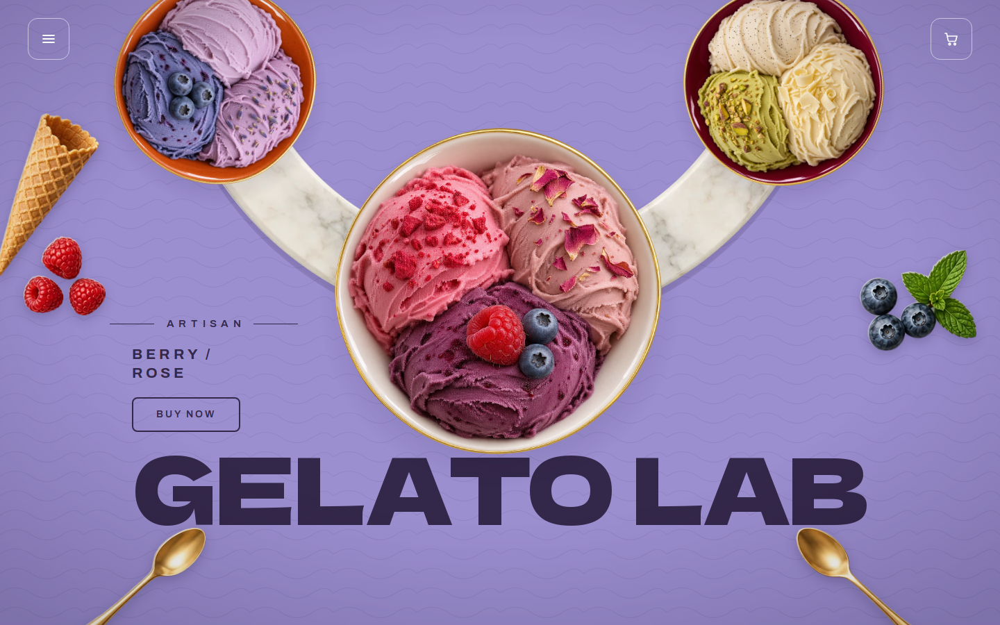

# Giostra - Artisan Gelato Carousel Landing Experience

A **vivid, playful product experience** built with Next.js, TypeScript, and modern CSS for the fictional brand Gelato Lab, featuring a flavour-driven colour world, choreographed motion design, and a marble lazy-susan carousel. *Giostra* is Italian for merry-go-round.

---

## Features

- Full-screen hero with five ceramic gelato bowls riding a marble ring that turns on its own, framed by an oversized chunky title and glass-outlined navigation buttons
- Five flavours, Berry Rose, Pistachio Cream, Mango Passion, Dark Choc Hazelnut and Blueberry Lavender, each with its own background and ink colour
- Choreographed flavour transition with a background and typography colour morph, a 72° ring turn where the bowls spin, grow and shrink, and a flavour name that fades out and back in
- Custom desktop cursor shaped like a miniature marble wheel, with contextual labels over draggable and clickable items
- Pinned horizontal flavour showcase, a velocity-reactive marquee, word-by-word text reveals and stacking process cards with animated counters
- Interactive play zone with a build-your-own box of four on a spinnable wheel, and a table of bowls, cones and spoons to drag and throw
- Front-end only cart with flying bowl feedback and a newsletter form with email validation (no checkout, and no data sent)
- Responsive English interface with smooth scrolling, reduced-motion support, keyboard-accessible controls, and a custom brand icon

---

## Technologies Used

- **Next.js 16 (App Router)** - React framework with Turbopack and static generation
- **React 19** - Component-based UI architecture and modern React hooks
- **TypeScript** - Strongly typed JavaScript for robust scalability and maintainable development
- **Modern CSS** - Custom properties, radial masks and a design-unit system that scales the hero to any screen
- **GSAP + Motion** - ScrollTrigger, SplitText, Draggable and Inertia for scroll and drag, Motion for springs, dialogs and flying bowls
- **Higgsfield artwork** - Transparent top-down bowls, props sheet and marble ring served through images.higgs.ai
- **Lenis** - Smooth scrolling and eased anchor navigation
- **Custom Google Fonts** - Dela Gothic One and Archivo, self-hosted through `next/font`

---

## Preview

